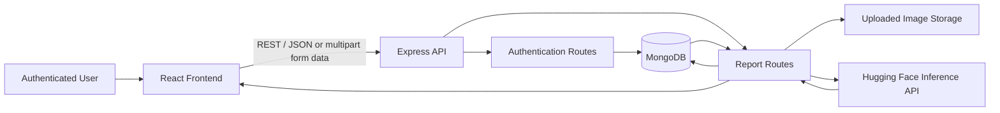
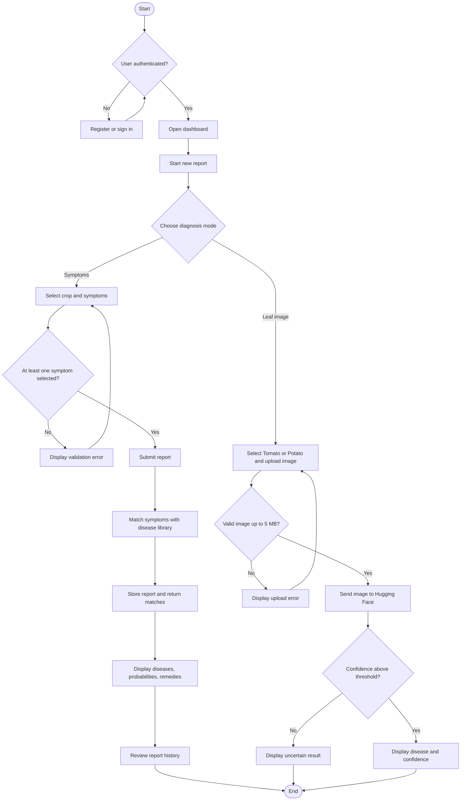
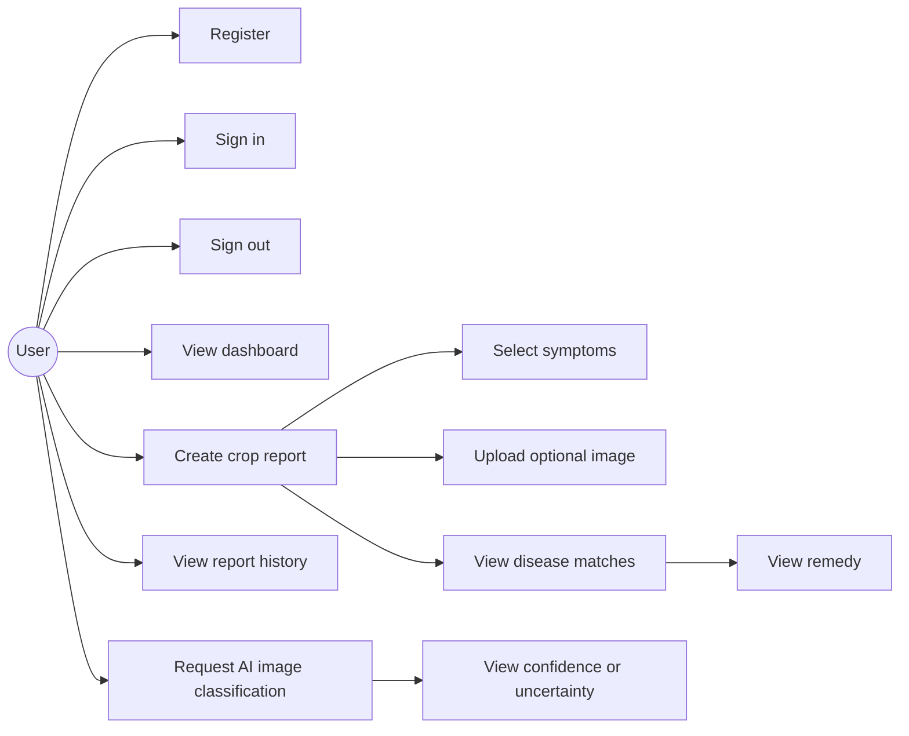
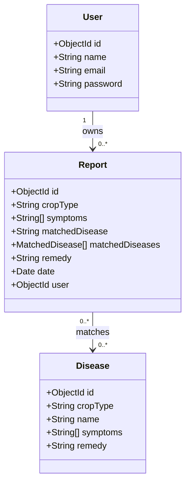
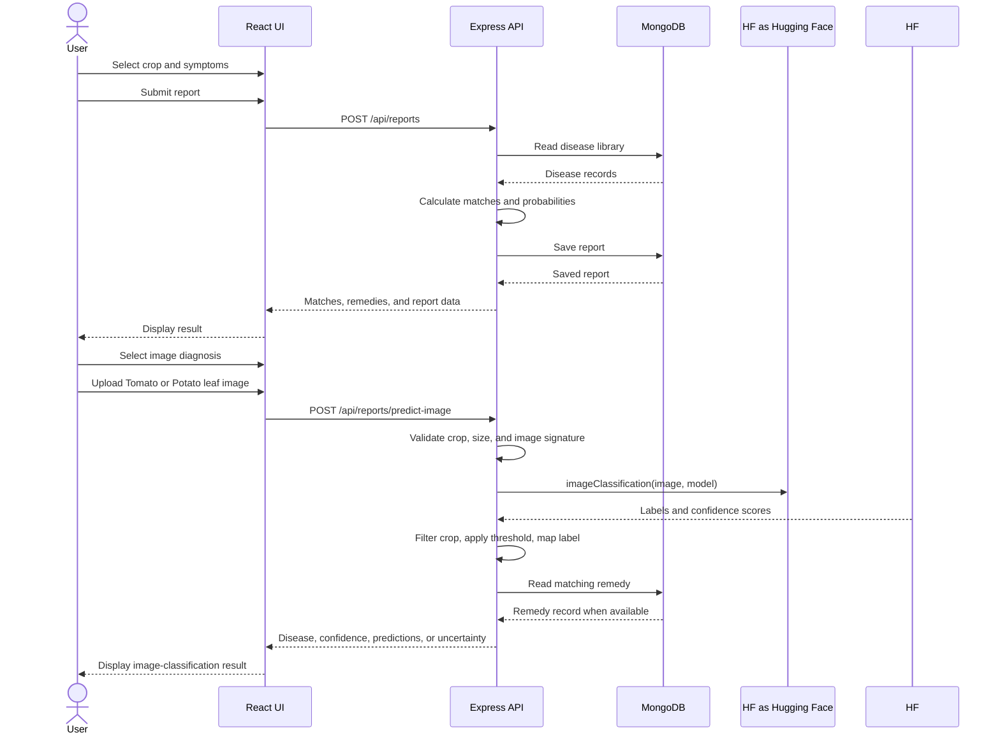
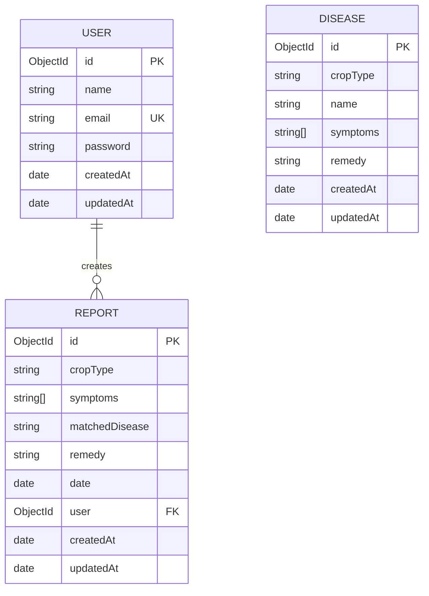

# Project Report

## VrukshSaathi: Crop Disease Reporting and Monitoring System

> **Formatting instruction:** Prepare the final document using the prescribed institutional template. Markdown is being used here as the editable content source; it does not itself enforce Times New Roman, line spacing, margins, or page numbering.

### Student and Project Details

| Item | Details |
|---|---|
| Student name | `[Enter student name]` |
| Roll number | `[Enter roll number]` |
| Programme / class | `[Enter programme and class]` |
| Guide / supervisor | `[Enter guide name]` |
| Department | `[Enter department]` |
| Institution | `[Enter institution name]` |
| Academic year | `[Enter academic year]` |

## Formatting Requirements

- Use **Times New Roman** throughout the report.
- Use **14 pt, bold, left-aligned and justified text with 1.5 line spacing** for chapter subtopics and section headings.
- Use **12 pt, justified text with 1.5 line spacing** for body text.
- Keep the chapter titles and numbering exactly as required by the institutional template.
- Redraw simple diagrams, figures, and tables instead of copying them from external sources.
- Write the report in a consistent tense. Describe the implemented system in the past tense where appropriate and describe general facts in the present tense.
- Replace every bracketed placeholder before submission.
- Number and caption every figure and table according to the institutional template.

# Chapter 1: Introduction

## 1.1 Background

Crop diseases can reduce crop quality and yield when symptoms are not identified and recorded at an early stage. Farmers and students may need a simple way to record visible symptoms, compare them with a disease library, and review earlier observations.

**VrukshSaathi** is a web-based crop health application developed to help users record crop observations. A registered user can select a crop, select visible symptoms, optionally upload a crop image for AI classification, and submit a report. The system compares selected symptoms with disease information stored in MongoDB and can send a Tomato or Potato leaf image to the Hugging Face Inference API. It presents possible disease matches, relative probabilities, image-classification confidence, and remedies. The submitted reports can later be reviewed through the dashboard and history screens.

## 1.2 Problem Statement

Existing manual observation methods do not always provide a consistent way to record crop symptoms and previous findings. Important details may be forgotten, disease information may be difficult to compare, and reports may not be available in one place. The problem addressed by this project is to design and implement a web application that allows authenticated users to record crop symptoms, receive disease-library-based matches, and maintain a history of crop health reports.

## 1.3 Motivation

The motivation for selecting this topic was to provide a practical digital tool for crop observation and basic disease awareness. The application combines a structured symptom form, optional image evidence, symptom-based disease matching, Hugging Face image classification, remedy information, and report history in one interface. This can make observations easier to organize and can support early discussion of possible crop diseases.

## 1.4 Objectives

The objectives of the project are:

1. To provide user registration and login functionality.
2. To allow users to select a crop and record visible symptoms.
3. To support optional upload of a crop image for image-based classification.
4. To compare selected symptoms with the stored disease library.
5. To display possible disease matches, match probabilities, and remedies.
6. To integrate a hosted Hugging Face model for Tomato and Potato leaf-image classification.
7. To store reports and return clear results or uncertainty messages for authenticated users.
8. To provide dashboard statistics and a history of submitted reports.

## 1.5 Scope of Work

The scope of the implemented system includes:

- User registration, login, and logout.
- Crop selection for Cotton, Tomato, Potato, and Cucumber.
- Selection of predefined visible symptoms.
- Optional JPEG, PNG, or WebP image upload.
- AI image classification for Tomato and Potato using the Hugging Face Inference API.
- Disease matching using the configured MongoDB disease library.
- Display of possible matches and remedy recommendations.
- Storage and retrieval of user-specific reports.
- Dashboard statistics such as total reports, crops scanned, and disease counts.

The current system does not replace laboratory diagnosis or expert agricultural advice. Symptom matching uses the configured disease library, while image classification uses the configured Hugging Face model. Predictions are confidence-based and should be treated as decision support rather than a confirmed diagnosis.

## 1.6 Limitations

The limitations identified during development are:

- The accuracy of a match depends on the completeness and correctness of the disease seed data.
- Image classification is currently available only for Tomato and Potato.
- Image-prediction accuracy depends on the Hugging Face model, image quality, and confidence threshold.
- The available crop and symptom choices are predefined.
- A MongoDB connection is required for persistent storage.
- The application should be evaluated with a larger set of real-world crop images and expert-verified results before production use.

# Chapter 2: Literature Review

## 2.1 Digital Crop Disease Identification

Write a review of existing crop disease identification systems, including symptom-based systems, image-based systems, and mobile or web-based agricultural advisory tools. Compare their input methods, disease data sources, output format, and intended users.

## 2.2 Symptom-Based Matching

Describe how symptom-based matching systems use observable symptoms to narrow possible diseases. Discuss the advantages of structured symptom selection, such as consistent data entry and explainable results, as well as its limitations when symptoms overlap between diseases.

## 2.3 Image-Assisted Agricultural Applications

Review applications that allow users to attach crop images. Explain how image uploads can provide additional context even when the image is not automatically classified. Include relevant published sources and cite them using the required institutional reference style.

## 2.4 Web Technologies Used in Related Systems

Discuss the use of React or similar frontend frameworks, Node.js and Express for REST APIs, and MongoDB for document-oriented storage in agricultural information systems.

## 2.5 Research Gap

Based on the reviewed work, identify the gap addressed by this project. For example, the project combines structured symptom reporting, optional image evidence, disease-library matching, remedies, authenticated report storage, and a history dashboard in a single lightweight web application.

## 2.6 Summary of Literature Review

Summarize the important findings from the reviewed literature and explain how they influenced the design of VrukshSaathi.

# Chapter 3: Methodology

## 3.1 Development Methodology

Describe the development approach followed for the project. Include requirement analysis, interface design, backend implementation, database design, integration, testing, and refinement.

## 3.2 System Requirements

### 3.2.1 Functional Requirements

- The system shall allow a new user to create an account.
- The system shall allow an existing user to sign in.
- The system shall allow an authenticated user to submit a crop report.
- The system shall allow the user to select one or more symptoms.
- The system shall optionally accept a crop image for a saved report.
- The system shall provide a separate image-prediction workflow for Tomato and Potato.
- The system shall send a valid image to the configured Hugging Face Inference API.
- The system shall return a disease label, confidence score, predictions list, and remedy when available.
- The system shall return an uncertainty response when the selected-crop prediction is below the configured confidence threshold.
- The system shall return one or more possible disease matches.
- The system shall display a remedy when it is available.
- The system shall save reports against the authenticated user.
- The system shall display report history and dashboard statistics.

### 3.2.2 Non-Functional Requirements

- The interface should be simple and responsive.
- User passwords should not be stored as plain text.
- API requests should be restricted to the required resources.
- Uploaded images should be limited to supported image formats and a maximum size of 5 MB.
- The application should return clear validation and error messages.
- The database should preserve report and disease information reliably.

## 3.3 System Architecture

The application uses a client-server architecture. The React frontend sends HTTP requests to the Express API. The API authenticates users, processes report submissions, reads disease information, stores reports, and communicates with MongoDB. Uploaded images are served through the backend uploads route.

**Figure 3.1:** System architecture of VrukshSaathi.  
*Redraw this diagram in the institutional format before submission.*

## 3.4 Application Flow

**Figure 3.2:** Report submission flow.  
*Redraw this diagram in the institutional format before submission.*

## 3.5 UML Diagrams

### 3.5.1 Use Case Diagram

**Actor:** Authenticated user  
**Use cases:** Register, sign in, sign out, view dashboard, create symptom report, select symptoms, upload image, request AI image classification, view disease matches, view confidence, view remedies, view report history.

**Figure 3.3:** Use case diagram.  
*Convert this into a standard UML use case diagram before submission.*

### 3.5.2 Class Diagram

The main persistent classes are `User`, `Disease`, and `Report`. `Report` is associated with a user and contains one or more matched disease results.

**Figure 3.4:** Class diagram.  
*Redraw this diagram using the notation required by the institution.*

### 3.5.3 Sequence Diagram

**Figure 3.5:** Report creation sequence diagram.  
*Redraw this diagram using standard UML notation before submission.*

## 3.6 Database Design

### 3.6.1 Entity Relationship Description

- A **User** can create many **Reports**.
- Each **Report** belongs to one user.
- A **Disease** stores crop type, disease name, symptoms, and remedy information.
- A **Report** stores the selected symptoms and embedded matched disease results.

**Figure 3.6:** Entity relationship diagram.  
*Redraw this diagram according to the institutional template.*

### 3.6.2 Database Collections

| Collection | Important fields | Purpose |
|---|---|---|
| `users` | `name`, `email`, `password` | Stores registered user accounts. |
| `diseases` | `cropType`, `name`, `symptoms`, `remedy` | Stores the disease reference library. |
| `reports` | `cropType`, `symptoms`, `matchedDiseases`, `remedy`, `user`, `date` | Stores submitted crop observations and results. |

## 3.7 Module Description

### 3.7.1 Authentication Module

The authentication module provides registration and login forms. The backend validates credentials, hashes passwords using `bcryptjs`, and returns a JSON Web Token for authenticated API requests. The frontend stores the session token and user information in browser local storage.

### 3.7.2 Dashboard Module

The dashboard displays the total number of reports, the number of crops scanned, and the most frequently observed disease signal. It also displays recent disease patterns and provides an entry point for creating a new report.

### 3.7.3 Report Module

The report module allows the user to select a crop, choose visible symptoms, attach an optional image, and submit the observation. The backend compares the submitted symptoms with the disease library, calculates relative match probabilities, and returns possible matches and remedies.

### 3.7.4 Disease Library Module

The disease library is stored in MongoDB and synchronized from the seed data when the backend connects to the database. Each disease record is associated with a crop type and contains symptoms and a remedy.

### 3.7.5 History Module

The history module retrieves reports belonging to the authenticated user. It displays the report date, crop, attached image when available, symptoms, matched diseases, and relative probabilities.

### 3.7.6 File Upload Module

The backend accepts JPEG, PNG, and WebP uploads and limits the file size to 5 MB. Regular report images are stored in the uploads directory and exposed through the `/uploads` route. Image-prediction uploads use memory storage so the image buffer can be sent to the prediction service.

### 3.7.7 Hugging Face Image Classification Module

The image-classification module is implemented in `backend/services/imagePredictionService.js`. It uses the `@huggingface/inference` package and the `InferenceClient` to call the hosted `neghani/plantvillage-mobilenetv2` model. The module reads `HF_TOKEN`, `HF_MODEL`, `HF_TIMEOUT_MS`, and `CONFIDENCE_THRESHOLD` from the backend environment. It filters predictions for the selected crop, maps labels such as `Tomato___Early_blight` to readable disease names, retrieves a remedy from MongoDB when a mapping exists, and returns an uncertain result when confidence is insufficient. The endpoint is `POST /api/reports/predict-image`.

# Chapter 4: Implementation

## 4.1 Implementation Details

The system was implemented as a separate frontend and backend application. The frontend manages pages and user interaction. The backend exposes REST endpoints, validates requests, performs authentication, matches symptoms with disease data, and persists records in MongoDB.

The main frontend pages are:

- `Login.jsx` for registration and sign in.
- `Dashboard.jsx` for statistics and recent patterns.
- `ReportForm.jsx` for creating and analyzing crop reports.
- `History.jsx` for viewing saved reports.

The main backend components are:

- `app.js` for Express configuration, middleware, API routes, health checking, and error handling.
- `db.js` for connecting to MongoDB and synchronizing disease seed data.
- `models/User.js` for user records.
- `models/Disease.js` for disease records.
- `models/Report.js` for report records.
- `routes/authRoutes.js` for authentication endpoints.
- `routes/reportRoutes.js` for report, disease, and statistics endpoints.
- `controllers/reportController.js` for report operations and image-prediction request handling.
- `services/imagePredictionService.js` for Hugging Face requests, label mapping, confidence checks, and prediction responses.
- `middleware/uploadMiddleware.js` for image type, size, and file-signature validation.

## 4.2 Technologies Used

| Technology | Use in the project |
|---|---|
| React | Frontend user interface and page components. |
| Vite | Frontend development server and build tool. |
| Axios | HTTP communication between frontend and backend. |
| Node.js | Backend JavaScript runtime. |
| Express | REST API framework. |
| MongoDB | Persistent document database. |
| Mongoose | MongoDB schema and model layer. |
| JSON Web Token | Authentication session tokens. |
| bcryptjs | Password hashing. |
| Multer | Image upload handling. |
| `@huggingface/inference` | Calls the hosted Hugging Face image-classification model. |
| Hugging Face Inference API | Classifies Tomato and Potato leaf images. |
| CORS | Cross-origin API access during development. |

## 4.3 Input Screens

Insert screenshots of the following screens. Use screenshots captured from the working application and add captions.

1. Registration screen.
2. Login screen.
3. Dashboard screen.
4. New report screen with crop and symptom selection.
5. Optional image upload state.
6. Image diagnosis screen with the selected crop and uploaded image.

**Figure 4.1:** Registration and login screen.  
**Figure 4.2:** Dashboard screen.  
**Figure 4.3:** New crop report input screen.

## 4.4 Output Screens

Insert screenshots of the following outputs:

1. Disease match result with relative probability.
2. Remedy recommendation and disease details dialog.
3. Dashboard statistics after reports are submitted.
4. Report history screen containing saved observations.
5. Validation or error message for an invalid submission.
6. Hugging Face disease result with confidence and prediction list.
7. Uncertain image-classification or provider-error message.

**Figure 4.4:** Disease match and remedy output.  
**Figure 4.5:** Dashboard statistics output.  
**Figure 4.6:** Saved report history output.
**Figure 4.7:** Hugging Face image-classification result.
**Figure 4.8:** Image-classification validation or uncertain-result output.

## 4.5 Testing Methods

Testing was performed using functional testing of the user interface and API integration testing. Complete the table with the actual test date, environment, observed output, and evidence.

| Test ID | Test case | Input / action | Expected result | Actual result | Status |
|---|---|---|---|---|---|
| T01 | User registration | Enter valid name, email, and password | Account is created and user is signed in | `[Record result]` | `[Pass/Fail]` |
| T02 | Invalid registration | Submit missing or invalid fields | Validation or API error is displayed | `[Record result]` | `[Pass/Fail]` |
| T03 | User login | Enter valid credentials | User reaches dashboard | `[Record result]` | `[Pass/Fail]` |
| T04 | Invalid login | Enter incorrect credentials | Error message is displayed | `[Record result]` | `[Pass/Fail]` |
| T05 | Empty symptom submission | Submit report without symptoms | User is asked to select a symptom | `[Record result]` | `[Pass/Fail]` |
| T06 | Valid report submission | Select crop and symptoms | Disease matches and remedy are returned | `[Record result]` | `[Pass/Fail]` |
| T07 | Image upload | Attach supported image below 5 MB | Image is accepted and displayed | `[Record result]` | `[Pass/Fail]` |
| T08 | Oversized image | Attach image above 5 MB | Upload is rejected with an error | `[Record result]` | `[Pass/Fail]` |
| T09 | Report history | Open history after saving a report | User's saved report is displayed | `[Record result]` | `[Pass/Fail]` |
| T10 | Dashboard statistics | Open dashboard with saved reports | Counts and disease patterns are shown | `[Record result]` | `[Pass/Fail]` |
| T11 | Responsive layout | Use desktop and mobile widths | Main screens remain usable | `[Record result]` | `[Pass/Fail]` |
| T12 | API health | Request `/api/health` | API returns `{ "status": "ok" }` | `[Record result]` | `[Pass/Fail]` |
| T13 | Valid Tomato image prediction | Upload a valid Tomato image with `cropType=Tomato` | API returns disease, confidence, and predictions from Hugging Face | `[Record result]` | `[Pass/Fail]` |
| T14 | Valid Potato image prediction | Upload a valid Potato image with `cropType=Potato` | API returns a Potato disease prediction and confidence | `[Record result]` | `[Pass/Fail]` |
| T15 | Unsupported prediction crop | Submit `Cotton` or `Cucumber` to `/api/reports/predict-image` | API returns status 400 with the supported-crops message | `[Record result]` | `[Pass/Fail]` |
| T16 | Missing prediction image | Submit a prediction request without an image | API returns status 400 with an image-required message | `[Record result]` | `[Pass/Fail]` |
| T17 | Invalid prediction image | Submit a text or corrupted file with an image extension | API rejects the file with an invalid-format message | `[Record result]` | `[Pass/Fail]` |
| T18 | Prediction image above 5 MB | Upload an image larger than 5 MB | API rejects the upload with a size-limit message | `[Record result]` | `[Pass/Fail]` |
| T19 | Missing Hugging Face token | Run prediction without `HF_TOKEN` | Service returns status 503 and a configuration message | `[Record result]` | `[Pass/Fail]` |
| T20 | Low-confidence prediction | Use a result below `CONFIDENCE_THRESHOLD` | API returns `status: "uncertain"` and an uncertainty message | `[Record result]` | `[Pass/Fail]` |

## 4.6 Testing Results

Summarize the completed testing results here. State the number of passed and failed tests, explain any failures, and describe the corrective actions taken. Do not claim a test passed unless it was actually executed and observed.

| Result | Count |
|---|---:|
| Passed | `[Enter count]` |
| Failed | `[Enter count]` |
| Blocked / not executed | `[Enter count]` |

# Chapter 5: Conclusion

## 5.1 Summary of Achievements

The project implemented a web-based crop health reporting system named VrukshSaathi. It provides account management, crop and symptom selection, optional report-image uploads, symptom-based disease-library matching, Hugging Face image classification for Tomato and Potato, confidence and uncertainty handling, remedy display, dashboard statistics, and report history. The separation of the React frontend from the Node.js and Express backend supports a clear application structure, while MongoDB provides persistent storage for users, diseases, and reports.

Rewrite this section in the student's own words after completing testing. Include the actual outcomes and the most important learning from the implementation.

## 5.2 Limitations

The main limitations are dependence on predefined symptoms and disease data, image classification limited to Tomato and Potato, dependence on the configured Hugging Face model and token, possible provider timeouts or loading errors, the effect of image quality on confidence, and the need for MongoDB configuration for persistent storage. The system should be treated as an observation and information-support tool rather than a replacement for expert diagnosis.

Add any limitations discovered during testing, such as deployment constraints, incomplete data, or usability issues.

## 5.3 Future Scope and Enhancements

Possible future enhancements include:

- Adding more crops, diseases, symptoms, and region-specific remedies.
- Adding expert review or agricultural officer feedback.
- Extending Hugging Face image classification to additional crops after collecting verified images and evaluating model performance.
- Adding multilingual support for farmers.
- Adding offline or low-bandwidth support for field use.
- Adding notifications for follow-up observations.
- Providing exportable PDF reports and trend charts.
- Adding role-based access for administrators and agricultural experts.
- Adding stronger production security, monitoring, and deployment configuration.

# References

Use the reference style specified by the institution. Include only sources that were actually consulted and cited in the report.

1. `[Author/Organization]. ([Year]). [Title of source]. [Publisher or website]. [URL/DOI]`
2. `[Author/Organization]. ([Year]). [Title of source]. [Publisher or website]. [URL/DOI]`
3. `[Author/Organization]. ([Year]). [Title of source]. [Publisher or website]. [URL/DOI]`
4. `[Documentation source for React, Node.js, Express, MongoDB, or another technology actually used].`

## Final Submission Checklist

- [ ] All student and institution details are completed.
- [ ] The prescribed institutional template has been applied.
- [ ] Chapter subtopics use 14 pt bold Times New Roman, left alignment, justification, and 1.5 spacing.
- [ ] Body text uses 12 pt Times New Roman, justification, and 1.5 spacing.
- [ ] All placeholders have been replaced.
- [ ] Diagrams have been redrawn and numbered.
- [ ] Screenshots have been captured from the working application and captioned.
- [ ] Testing results contain actual evidence rather than assumed results.
- [ ] Conclusions are written in the student's own words.
- [ ] References are complete and consistently formatted.
